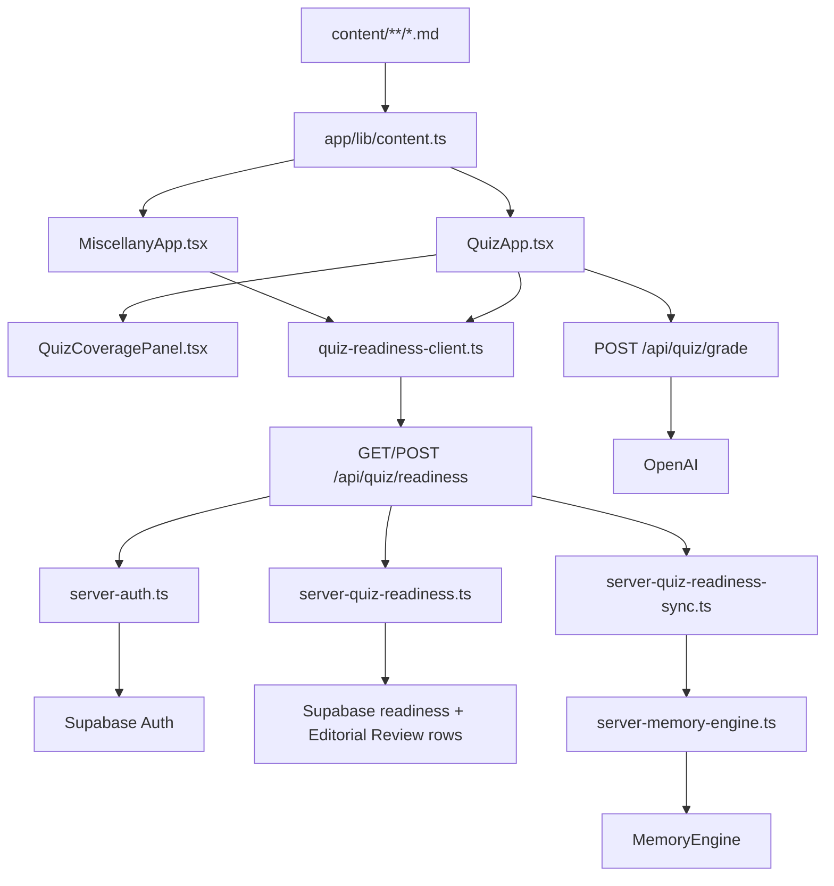

# Miscellany Code Map

## Current Runtime

`docs/security-architecture.md` is the detailed request-and-credential boundary diagram and inventory.

## Ownership

- `content/**/*.md` and `app/lib/content.ts` own entries, slugs, questions, answers, rubrics, stable question IDs, and active/retired question state.
- `app/lib/quiz-readiness.ts`, `app/lib/quiz-readiness-client.ts`, `app/lib/server-quiz-readiness.ts`, and `app/api/quiz/readiness/route.ts` own the user-scoped readiness contract and one bulk read/update path.
- `app/lib/quiz-readiness-sync.ts` performs the bounded, idempotent server-side registration attempt after readiness has been persisted.
- `app/lib/quiz-coverage.ts` is the pure hierarchy, filtering, and aggregate-count model; `app/components/QuizCoveragePanel.tsx` renders its modest browse-and-select UI.
- `app/lib/server-memory-engine.ts` and `app/api/memory-engine/*` are the server-to-server learning boundary. Browser code calls only Miscellany routes.
- `app/lib/auth.ts`, `app/lib/use-auth-session.ts`, and `app/lib/server-auth.ts` own browser session state and server-side Supabase token/immutable-owner validation.
- `app/lib/review.ts` and `app/api/review/*` own active Editorial Review rows in Supabase.
- `app/lib/openai-grading.ts` and `app/api/quiz/grade/route.ts` grade typed answers server-side without sending full entry prose.

## Operational Notes

- The applied migration is `supabase/migrations/202608280001_miscellany_quiz_entry_readiness.sql`.
- Historical reconstruction marked 11 of 121 entries ready at migration time; current counts are calculated, not hard-coded.
- `npm run dev` loads the Git-ignored project `.env.local` for local development; without it, public-mode browsing remains available.
