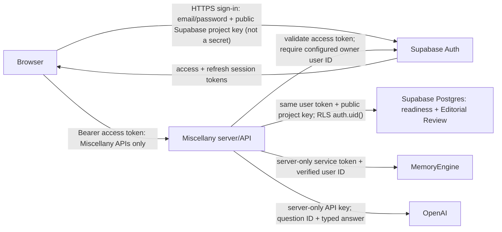

# Security Architecture

## Request And Trust Boundaries

The Supabase project URL and publishable key are intentionally browser-visible. Together they select the public Supabase API for this project; they do not identify the signed-in user or bypass Auth and RLS. The access token identifies the authenticated user. The browser never receives server-only credentials.

## Configuration Inventory

| Configuration | Classification | Authorized consumer | Local / deployment scope |
| --- | --- | --- | --- |
| `NEXT_PUBLIC_SUPABASE_URL`, `NEXT_PUBLIC_SUPABASE_PUBLISHABLE_KEY` | Public browser configuration | Browser and Miscellany | Git-ignored `.env.local`; Vercel environments |
| `SUPABASE_URL`, `SUPABASE_PUBLISHABLE_KEY` | Non-secret server configuration | Miscellany server | Git-ignored `.env.local`; Vercel environments |
| `MISCELLANY_OWNER_USER_ID` | Server-only authorization configuration | Miscellany server | Git-ignored `.env.local`; Vercel Production secret |
| `MEMORYENGINE_URL` | Non-secret server configuration | Miscellany server | Git-ignored `.env.local`; Vercel environments |
| `MEMORYENGINE_SERVICE_TOKEN` | Server-only secret | Miscellany and MemoryEngine servers | Git-ignored `.env.local`; protected Vercel secret |
| `OPENAI_API_KEY` | Server-only secret | Miscellany server | Optional for local typed grading; protected Vercel secret |
| `OPENAI_GRADING_MODEL` | Non-secret server configuration | Miscellany server | Optional local/deployment setting |
| Supabase service-role and database credentials | Server-only secrets | Supabase administrative or database clients only | Never browser-visible; protected deployment/local service configuration |

`.env.local` is a conventional project-local runtime file and is Git-ignored. `.env.example` contains names only. Deployment configuration lives in Vercel environment variables. No passwords, browser sessions, tokens, credential values, or machine-specific storage locations belong in this repository or its public documentation.

## Authorization Model

Supabase signup is disabled and the project currently has a single Auth user. Miscellany nevertheless checks the immutable Supabase user ID against `MISCELLANY_OWNER_USER_ID` on every private API route. This preserves an explicit owner boundary if another Auth user is introduced later. Supabase RLS separately binds readiness and Editorial Review rows to `auth.uid()`.
